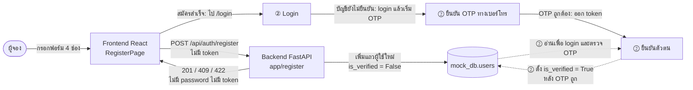
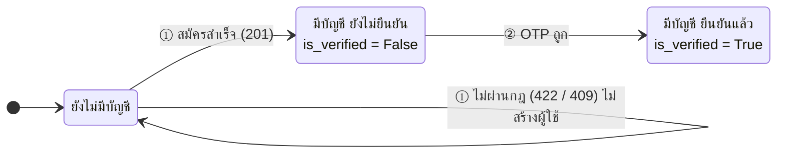
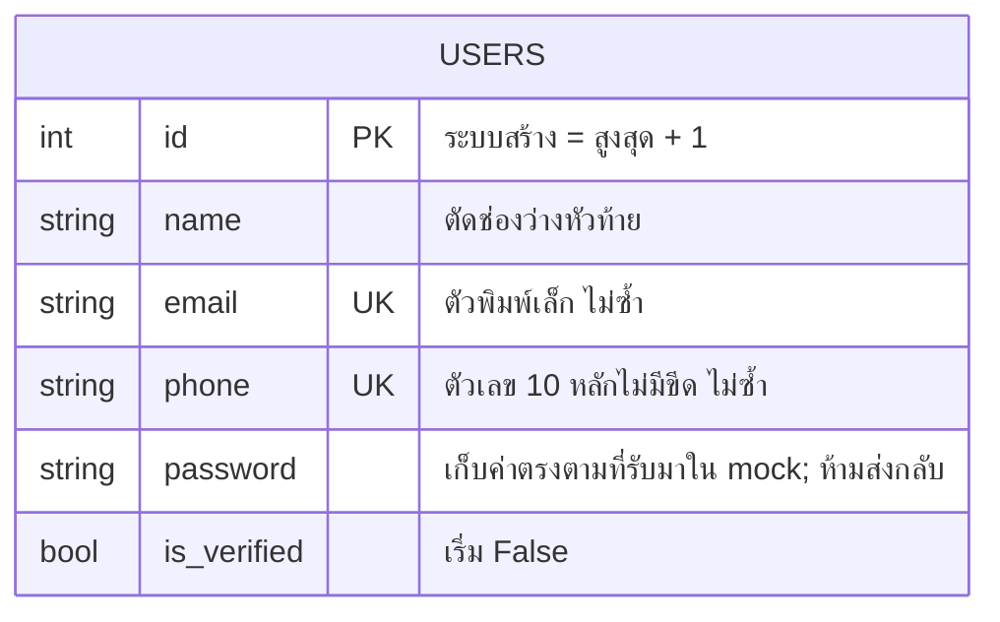

# models.md แบบจำลองของ feature ① ลงทะเบียน (MD-xx-01)

เวอร์ชัน 1.7 (draft ยังไม่เข้า Baseline) | อ้าง: spec.md v1.10 ส่วน 3, 5, 7 และ rules.md | แผนภาพเขียนด้วย Mermaid (เปิดดูใน VS Code ด้วย extension Markdown Preview Mermaid Support หรือใน GitHub)
**รหัส MD-xx-01 AI เสนอ ทีมยืนยันใน prompt-log** ถ้าแผนภาพกับ spec.md ขัดกัน ให้ถือ spec.md เป็นหลักแล้วเพิ่มเป็น Q-xx

## MD-CTX-01 บริบทของ feature ① (Context)

ใครคุยกับ ① และ ① แตะข้อมูลอะไร (spec ส่วน 3) เส้นประคือสิ่งที่ ① **ไม่ทำ** เป็นของ ②

| องค์ประกอบ | ของใคร | ① ทำอะไรกับมัน |
|---|---|---|
| RegisterPage (React) | ① | แสดงฟอร์ม ตรวจเบื้องต้น แสดง error ใต้ช่อง |
| `POST /api/auth/register` | ① | รับคำขอ ตรวจกฎ BR-RG สร้างผู้ใช้ |
| `mock_db.users` | กลุ่ม (ไฟล์กลาง) | เพิ่มแถว และอ่านเพื่อตรวจซ้ำ |
| OTP ทางเบอร์โทร, login ด้วย email/password, token | ② | หลังสมัครส่งไป `/login`; ② เป็นเจ้าของ login/OTP |

## MD-STM-01 วงจรชีวิตของผู้ใช้ (State Machine)

สถานะของผู้ใช้ตามค่า `is_verified` (spec ส่วน 5, BR-RG-08) ① เป็นผู้ทำให้เกิดขั้นแรกเท่านั้น

| การเปลี่ยน | ใครทำ | เงื่อนไข | กฎ / AC |
|---|---|---|---|
| ยังไม่มีบัญชี → ยังไม่ยืนยัน | ① | ข้อมูลผ่าน BR-RG-01 ถึง 06 | BR-RG-07, BR-RG-08 · AC-01-01 |
| ยังไม่มีบัญชี → ยังไม่มีบัญชี | ① | ไม่ผ่านรูปแบบ (422) หรือซ้ำ (409) | BR-RG-10 · AC-01-03 ถึง AC-01-10 |
| ยังไม่ยืนยัน → ยืนยันแล้ว | ② | OTP ถูก (AS-02) | นอกขอบเขต ① |

ไม่มีการเปลี่ยนจากยืนยันแล้วกลับเป็นยังไม่ยืนยันใน feature ใด และ ① ไม่ลบหรือแก้ผู้ใช้เดิม
หลังสมัคร ① ส่งผู้ใช้ไป `/login`; ② รับ email/password และเริ่ม OTP หากบัญชียังไม่ verified; เมื่อ OTP ถูกต้องจึงออก token. บัญชี verified login ได้โดยไม่ทำ OTP ซ้ำ (Q-04)

## MD-DOM-01 แบบจำลองข้อมูล (Domain Model)

มีเอนทิตีเดียวที่ ① เขียน คือ `users` ใน `mock_db.py` (spec ส่วน 7, REQ-DAT-101)

| attribute | ชนิด | กฎ | ใครเขียน | ใครอ่าน |
|---|---|---|---|---|
| `id` | จำนวนเต็ม | BR-RG-07 | ① | ② ③ ④ ⑤ ⑥ (ผ่าน `get_current_user()`) |
| `name` | ข้อความ | BR-RG-01 | ① | ② |
| `email` | ข้อความ | BR-RG-02, BR-RG-05; ใช้เป็น username สำหรับ login | ① | ② |
| `phone` | ข้อความ | BR-RG-03, BR-RG-06 | ① | ② |
| `password` | ข้อความ | BR-RG-04, BR-RG-09; REQ-PRV-101 | ① เก็บค่าตรงตามที่รับมาใน mock (D-01-02) | ② ตรวจ login จาก field เดียวกันตาม Auth ปัจจุบัน |
| `is_verified` | จริง/เท็จ | BR-RG-08 | ① ตั้ง False · ② ตั้ง True | ② |

ผู้ใช้ตัวอย่างเริ่มต้นตาม spec ส่วน 7 มีฟิลด์ตามตัวอย่างที่ระบุ; ค่าใน `password` เป็นค่าตรงตามที่รับมาใน mock ตาม D-01-02
ข้อมูลอยู่ใน `mock_db.py` แบบ mock ไม่มี database (REQ-CON-101)
