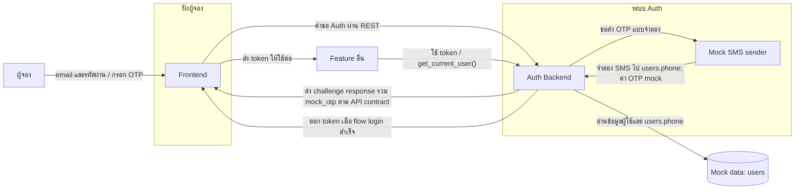
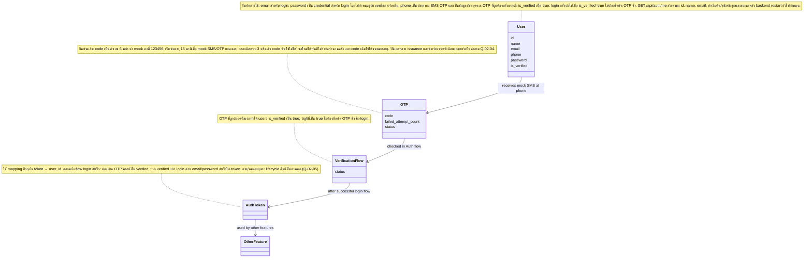

# โมเดล Auth — Feature 002

สถานะ: draft — ยังไม่เข้า Baseline | version: 1.0 (แม่แบบ)
ที่มา: `specs/002-auth/spec.md`, คำตอบทีมในขั้น `/clarify` และภาพรวมระบบ

**รหัส MD-02-01 ถึง MD-02-04 เป็น AI เสนอ รอทีมยืนยัน** ไม่พบรูปแบบ MD ID ที่ทีมอนุมัติไว้ในเอกสารที่ตรวจ

## MD-02-01 (AI เสนอ รอทีมยืนยัน): Context Diagram

`Mock SMS sender` เป็นส่วนจำลองภายในระบบ Auth ไม่ใช่ SMS provider หรือระบบภายนอกจริง ไม่มี external SMS integration ในขอบเขตนี้ การวาดการส่ง token และ OTP เป็นภาพรวมเชิงแนวคิด ไม่ได้กำหนด API request/response หรือรูปแบบ token.

Frontend รับ challenge response ตาม API contract รวม `mock_otp` แต่ไม่ render ค่ารหัส; ช่องกรอก OTP เริ่มว่างและผู้ใช้พิมพ์รหัสเอง.

ผู้ใช้ mock ที่มีอยู่ทั้งหมดใน `backend/app/mock_db.py` ได้รับอนุมัติจากทีมให้ใช้เป็น fixtures (Q-02-08).

## MD-02-02 (AI เสนอ รอทีมยืนยัน): Domain Model

### สถานะ attribute

| Entity | ยืนยันแล้ว | พบในภาพรวมแต่ความหมาย/การใช้ใน Auth ยังไม่ยืนยัน |
|---|---|---|
| `User` | `email` ใช้ login; `password` ใช้เป็น credential สำหรับ login โดยไม่กำหนดรูปแบบหรือการจัดเก็บ; `phone` เป็นปลายทางรับ SMS OTP และเป็นข้อมูลส่วนบุคคล; `id`, `name`, `email` ส่งกลับจาก `/api/auth/me`; OTP ที่ถูกต้องครั้งแรกตั้ง `is_verified=true`, การ login ต่อไปเมื่อเป็น `true` ไม่ต้องทำ OTP ซ้ำ | ค่าเริ่มต้นและชนิดข้อมูลของ `is_verified`; สถานะ `is_verified` หลัง backend restart |
| `OTP` | `code` เป็น `123456`; UI ไม่แสดงค่าและให้ผู้ใช้กรอกเอง; เริ่มนับอายุ 15 นาทีเมื่อ flow กรอก OTP แสดงผล; กรอกผิดครบ 3 ครั้งแล้ว code นั้นใช้ไม่ได้ | วิธีระบุหลายคำขอและนับจำนวนครั้งผิดแยกชุด เมื่อ OTP ทุกชุดใช้ code เดียวกัน |
| `VerificationFlow` | OTP ที่ถูกต้องและยังไม่หมดอายุทำให้ flow สำเร็จและตั้ง `users.is_verified=true`; บัญชีที่ `is_verified=true` ไม่ต้องยืนยัน OTP ซ้ำเมื่อ login | ค่าเริ่มต้นและชนิดข้อมูลของ `users.is_verified` |
| `AuthToken` | ใช้ mapping ปัจจุบัน `token → user_id` และใช้ต่อกับ Feature อื่น; ออกเมื่อ flow login สำเร็จ (OTP สำเร็จสำหรับบัญชีที่ยังไม่ verified หรือ email/password ถูกต้องสำหรับบัญชีที่ verified) | อายุ/หมดอายุและ lifecycle อื่นของ token |

ไม่กำหนดชนิดข้อมูล, รูปแบบหรือการจัดเก็บของ `password`, อายุ/หมดอายุและ lifecycle อื่นของ token, หรือรายละเอียดอื่นที่ไม่มีหลักฐานใน `spec.md` และคำตอบทีม.

`GET /api/auth/me` ส่งเฉพาะ `id`, `name`, `email`; ไม่ส่ง `phone`, `password`, OTP, token หรือ `is_verified` (Q-02-06).

## MD-02-03 (AI เสนอ รอทีมยืนยัน): State Diagram

### วงจรชีวิต OTP

```mermaid
stateDiagram-v2
  [*] --> Active: แสดง flow กรอก OTP โดยไม่แสดงค่ารหัส; เริ่มนับอายุ
  Active --> Active: กรอกผิดครั้งที่ 1 หรือ 2
  Active --> Verified: กรอกถูกก่อนหมดอายุ
  Active --> Invalid: กรอกผิดครบ 3 ครั้ง
  Active --> Expired: อายุครบ 15 นาที
  Verified --> [*]
  Invalid --> [*]
  Expired --> [*]
```

อายุ 15 นาทีเริ่มนับเมื่อ mock SMS/OTP แสดงผลแล้ว. การขอรหัสใหม่ทำได้ทันทีและไม่จำกัดจำนวนครั้ง; OTP เดิมยังใช้ได้จนหมดอายุ. วิธีแยก instance/state ของ OTP หลายรายการที่ใช้ค่า `123456` และนับจำนวนครั้งผิดแยกชุดยังไม่กำหนด (Q-02-04) จึงไม่แสดงการขอใหม่เป็นการเปลี่ยนสถานะของ OTP เดิม.

### สถานะการยืนยันใน Auth flow

```mermaid
stateDiagram-v2
  [*] --> Login: เริ่ม login ด้วย email/password
  Login --> AwaitingOTP: users.is_verified ไม่เป็น true
  Login --> LoginAccepted: users.is_verified เป็น true และ email/password ถูกต้อง; ออก token
  AwaitingOTP --> VerifiedInFlow: OTP ถูกต้องและยังไม่หมดอายุ / ตั้ง users.is_verified=true
  AwaitingOTP --> Login: OTP หมดอายุหรือใช้ไม่ได้
  VerifiedInFlow --> LoginAccepted: ยืนยันครั้งแรกสำเร็จ
  LoginAccepted --> [*]
```

บัญชีที่มี `users.is_verified=true` ข้ามขั้น OTP ในการ login ครั้งต่อไป; การ login ครั้งแรกที่ OTP ถูกต้องต้องบันทึกค่านี้เป็น `true`. ค่าเริ่มต้นและชนิดข้อมูลของ field และการคงค่า `is_verified` หลัง backend restart ยังไม่ยืนยัน. รายละเอียด token ยังไม่กำหนดครบ.

## MD-02-04 (AI เสนอ รอทีมยืนยัน): External Sequence

ไม่มี external sequence ที่ต้องกำหนดสำหรับ Auth ในขอบเขตนี้ เพราะการส่ง SMS เป็น mock ภายในระบบและไม่มีการเชื่อมต่อ SMS provider ภายนอกจริง. รายละเอียดลำดับภายในระหว่าง Frontend, Auth Backend และ mock sender ยังไม่กำหนดเป็น API/sequence contract.

## ประเด็นอ้างอิงที่ยังเปิด

- Q-02-04: วิธีระบุ OTP หลายคำขอที่ใช้ค่า `123456` พร้อมกัน และนับจำนวนครั้งผิดแยกชุด
- Q-02-05: อายุ/หมดอายุและ lifecycle อื่นของ token
- ค่าเริ่มต้นและชนิดข้อมูลของ `users.is_verified` และการคงค่านี้หลัง backend restart ยังไม่ยืนยัน
