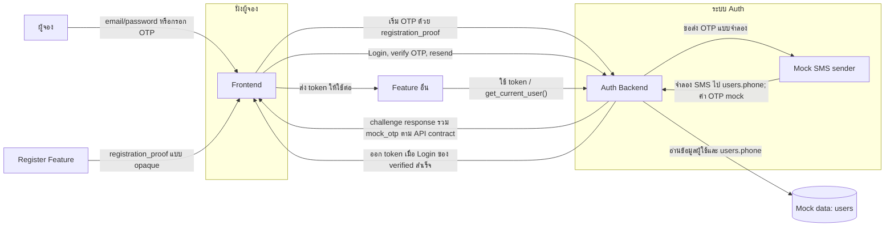

# โมเดล Auth — Feature 002

สถานะ: draft — ยังไม่เข้า Baseline | version: 1.0 (แม่แบบ)
ที่มา: `specs/002-auth/spec.md`, คำตอบทีมในขั้น `/clarify` และภาพรวมระบบ

**รหัส MD-02-01 ถึง MD-02-04 เป็น AI เสนอ รอทีมยืนยัน** ไม่พบรูปแบบ MD ID ที่ทีมอนุมัติไว้ในเอกสารที่ตรวจ

## MD-02-01 (AI เสนอ รอทีมยืนยัน): Context Diagram



`Mock SMS sender` เป็นส่วนจำลองภายในระบบ Auth ไม่ใช่ SMS provider จริง. `registration_proof` เป็น opaque ใช้ครั้งเดียวและผูกกับบัญชี; Auth แลกเป็น challenge ID แต่ไม่รับ `user_id` อย่างเดียวเป็นหลักฐาน. Frontend ไม่ render ค่า `mock_otp`; ช่อง OTP เริ่มว่าง.

ผู้ใช้ mock ที่มีอยู่ทั้งหมดใน `backend/app/mock_db.py` ได้รับอนุมัติจากทีมให้ใช้เป็น fixtures (Q-02-08).

## MD-02-02 (AI เสนอ รอทีมยืนยัน): Domain Model

```mermaid
classDiagram
  class User {
    id
    name
    email
    phone
    password
    is_verified
  }

  class RegistrationProof {
    opaque_value
    user_id
    used_once
  }

  class OTPChallenge {
    otp_challenge_id
    code
    failed_attempt_count
    status
    created_at
  }

  class AuthToken {
    token
    user_id
  }

  RegistrationProof --> User : ผูกกับบัญชี; ใช้เมื่อสร้าง challenge
  User --> OTPChallenge : receives mock SMS at phone
  User --> AuthToken : token is issued only on verified Login

  note for User "OTP ที่ถูกต้องครั้งแรกตั้ง is_verified=true; การยืนยัน OTP ไม่ออก token. Login ครั้งต่อไปเมื่อ is_verified=true ใช้ email/password และออก token. GET /api/auth/me ส่งเฉพาะ id, name, email."
  note for RegistrationProof "Opaque proof ผูกกับบัญชีและใช้เริ่ม OTP ได้ครั้งเดียว; proof ผิด/ใช้แล้วไม่สร้าง challenge."
  note for OTPChallenge "code เป็นตัวเลข 6 หลัก ค่า mock 123456; อายุ 15 นาที; กรอกผิดครบ 3 ครั้งปิดเฉพาะชุดนั้น. Resend สร้าง challenge ID ใหม่และไม่ยกเลิก challenge เก่าที่ยังไม่หมดอายุ."
  note for AuthToken "Mapping token → user_id; ออกเฉพาะหลัง Login สำเร็จของบัญชี verified. อายุเท่า process backend; ไม่มี refresh/revoke endpoint; ใช้ไม่ได้หลัง restart."
```

คำว่า `RegistrationProof` เป็นแนวคิดของ opaque proof ที่ทีมยืนยัน ไม่ได้เพิ่ม field ลงใน entity `users`. รูปแบบ/การจัดเก็บ password และ token ไม่กำหนดเพิ่มเติมนอก API contract.

### สถานะ attribute

| Entity | ยืนยันแล้ว | ขอบเขต / สิ่งที่ยังไม่กำหนด |
|---|---|---|
| `User` | `email` และ `password` ใช้ Login; `phone` เป็นปลายทางรับ SMS OTP; OTP ถูกต้องครั้งแรกตั้ง `is_verified=true`; `/me` ส่งเฉพาะ `id`, `name`, `email` | ค่าเริ่มต้น `is_verified` หลัง backend restart เป็นไปตาม fixture ตาม AS-02-01; ชนิดข้อมูล/validation ตาม API contract |
| `RegistrationProof` | opaque, ผูกกับบัญชี, ใช้ครั้งเดียว; proof ผิดหรือใช้แล้วตอบ 400 และไม่สร้าง challenge | format และการส่งผ่าน Register response ยังเป็นงานเชื่อมต่อของ Feature 001 |
| `OTPChallenge` | code `123456`; อายุ 15 นาที; ID แยกชุด; ผิดครบ 3 ครั้งปิดเฉพาะชุด; resend สร้าง ID ใหม่และ challenge เก่ายังใช้ได้จนหมดอายุ | ไม่มี SMS provider จริง |
| `AuthToken` | mapping `token → user_id`; ออกเฉพาะ Login สำเร็จของบัญชี verified; ใช้ได้ตลอดอายุ process backend; ไม่มี refresh/revoke endpoint | ใช้ไม่ได้หลัง restart; `/me` รับ `Authorization: Bearer <token>` |

`GET /api/auth/me` ส่งเฉพาะ `id`, `name`, `email`; ไม่ส่ง `phone`, `password`, OTP, token หรือ `is_verified` (Q-02-06).

## MD-02-03 (AI เสนอ รอทีมยืนยัน): State Diagram

### วงจรชีวิต OTP challenge

```mermaid
stateDiagram-v2
  [*] --> Active: proof ถูกต้อง; แสดง OTP flow และเริ่มนับอายุ
  Active --> Active: กรอกผิดครั้งที่ 1 หรือ 2
  Active --> Verified: กรอกถูกก่อนหมดอายุ
  Active --> Locked: กรอกผิดครบ 3 ครั้ง
  Active --> Expired: อายุครบ 15 นาที
  Verified --> [*]
  Locked --> [*]
  Expired --> [*]
```



Resend สร้าง challenge ใหม่ที่มี ID และจำนวนครั้งผิดแยกจากชุดเดิม; challenge เดิมยังใช้ได้จนหมดอายุหรือถูกปิดตามกติกา.

### ลำดับยืนยันบัญชีและ Login

```mermaid
stateDiagram-v2
  [*] --> AwaitingHandoff: สมัครสำเร็จ
  AwaitingHandoff --> AwaitingOTP: proof ถูกต้อง; สร้าง challenge
  AwaitingOTP --> Verified: OTP ถูกต้อง / ตั้ง users.is_verified=true
  Verified --> Login: กลับหน้า Login โดยไม่มี token
  Login --> Authenticated: credentials ถูกต้องและ is_verified=true / ออก token
  Login --> VerificationRequired: credentials ถูกต้องและ is_verified ไม่เป็น true / 403, ไม่มี token
  Authenticated --> [*]: ไปหน้า Booking
  VerificationRequired --> [*]
```



หลัง backend restart ให้ `is_verified` กลับเป็นค่าเริ่มต้นของ mock fixture โดยไม่เพิ่ม persistence (AS-02-01).

## MD-02-04 (AI เสนอ รอทีมยืนยัน): External Sequence

ไม่มี external sequence ที่ต้องกำหนดสำหรับ Auth ในขอบเขตนี้ เพราะการส่ง SMS เป็น mock ภายในระบบและไม่มีการเชื่อมต่อ SMS provider ภายนอกจริง. การเชื่อม Register เป็น handoff ระหว่าง Feature: Register ส่ง opaque `registration_proof` ให้ Frontend; Frontend เรียก Auth endpoint เพื่อรับ `otp_challenge_id` แล้วเปิดหน้า OTP. การแก้ Feature 001 อยู่นอกขอบเขตงานนี้.

## ประเด็นอ้างอิงที่ยังเปิด

- Q-02-01: แหล่ง Requirement ต้นฉบับ, PB/EV และรหัสทางการยังตรวจสอบไม่ได้
- Q-02-10: Labels, layout, UI ID และ mockup ของ Auth นอกเหนือจาก flow ที่ยืนยันแล้วยังเปิด
- Q-02-11: owner/PO/ผู้ตรวจและวันอนุมัติ Baseline ยังไม่กำหนด
