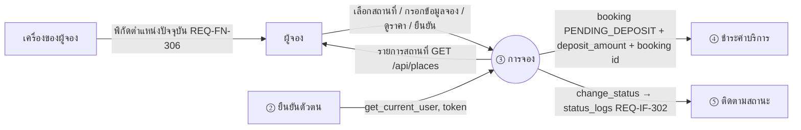
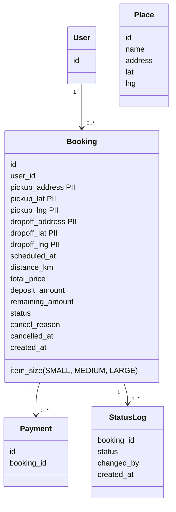
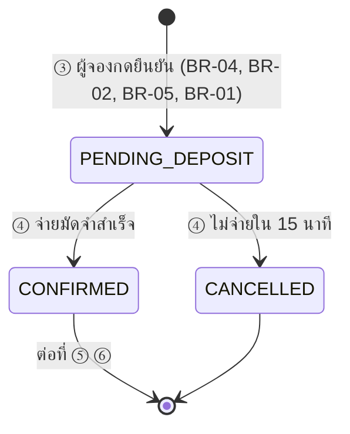
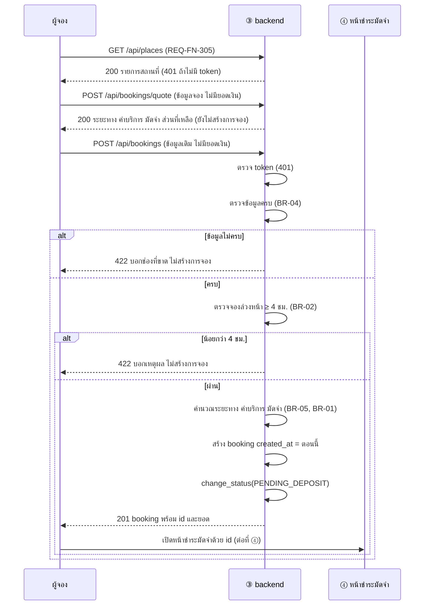

# โมเดลที่ feature ③ การจองใช้ (MD-CTX-03, MD-DOM-03, MD-STM-03, MD-SEQ-03)

เวอร์ชัน 1.0 (draft ยังไม่เข้า Baseline) | เขียนด้วย Mermaid เปิดดูภาพได้บน GitHub
ร่างจาก spec.md ของ ③ สัญญาระหว่าง ③ กับ ④ (spec ของ ④) และ `mock_db.py` ไม่มีภาพจากบทเรียน Integrated Requirements Modelling ของ feature นี้ รหัส MD AI เสนอ ทีมยืนยันใน prompt-log

## MD-CTX-03 Context Diagram (เฉพาะส่วนที่ feature นี้แตะ)

ไม่มีระบบภายนอกที่ ③ เรียก ระยะทางคำนวณในตัวระบบจากพิกัด (BR-05) และสถานที่มาจากรายการจำลอง (D-03-15)
บราวเซอร์ของผู้จองเป็นผู้ให้ตำแหน่งปัจจุบัน (REQ-FN-306) ไม่ใช่ระบบที่ ③ ควบคุม

## MD-DOM-03 Domain Model

③ เขียน Booking และ StatusLog (ผ่าน `change_status()`) อ่าน User และ Place ส่วน Payment เป็นของ ④
Place เป็นรายการสถานที่จำลองใน `mock_db.places` อ่านอย่างเดียว ไม่มีความสัมพันธ์กับ Booking เพราะค่าที่เลือก (address, lat, lng) ถูกคัดลอกเข้า Booking
ที่อยู่และพิกัดใน Booking เป็นข้อมูลส่วนบุคคล (รวมพิกัดตำแหน่งปัจจุบัน) ยังไม่มี REQ-PRV รองรับ (Q-05)

## MD-STM-03 วงจรชีวิตของการจอง (เฉพาะส่วนที่ ③ แตะ)

③ เป็นเจ้าของลูกศรแรกเท่านั้น ที่เหลือเป็นของ feature อื่น

## MD-SEQ-03 ลำดับการจอง (ขั้นที่มี exception)

