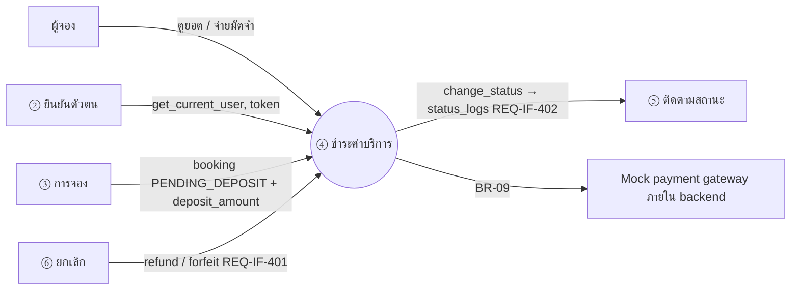
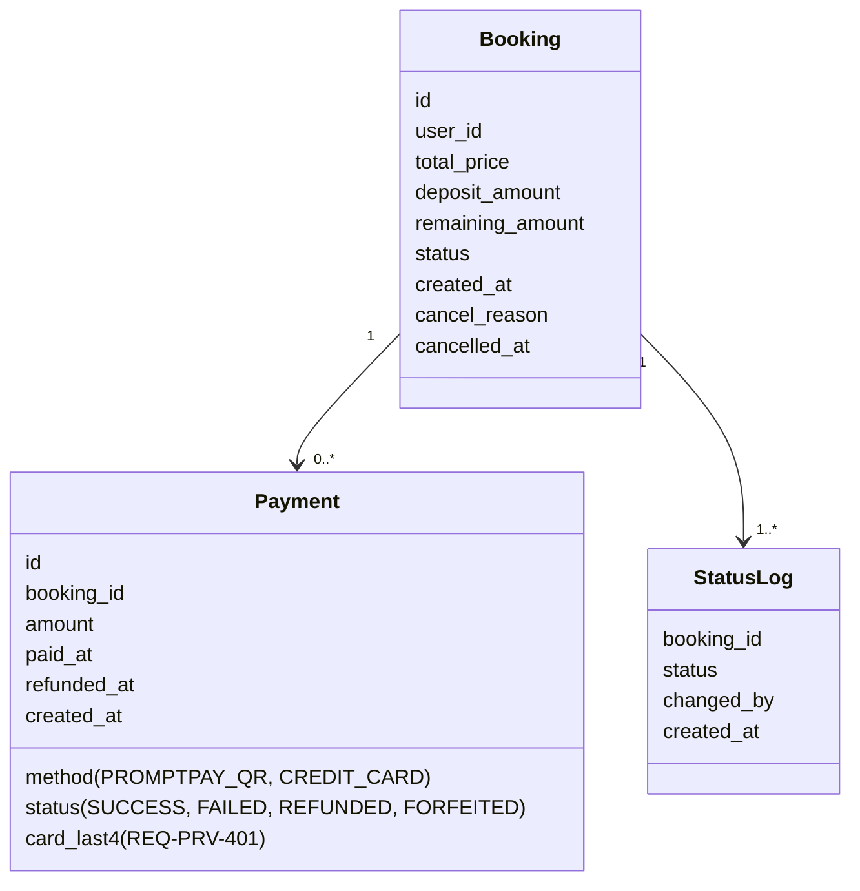
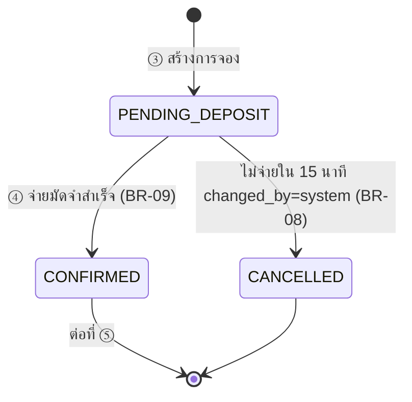
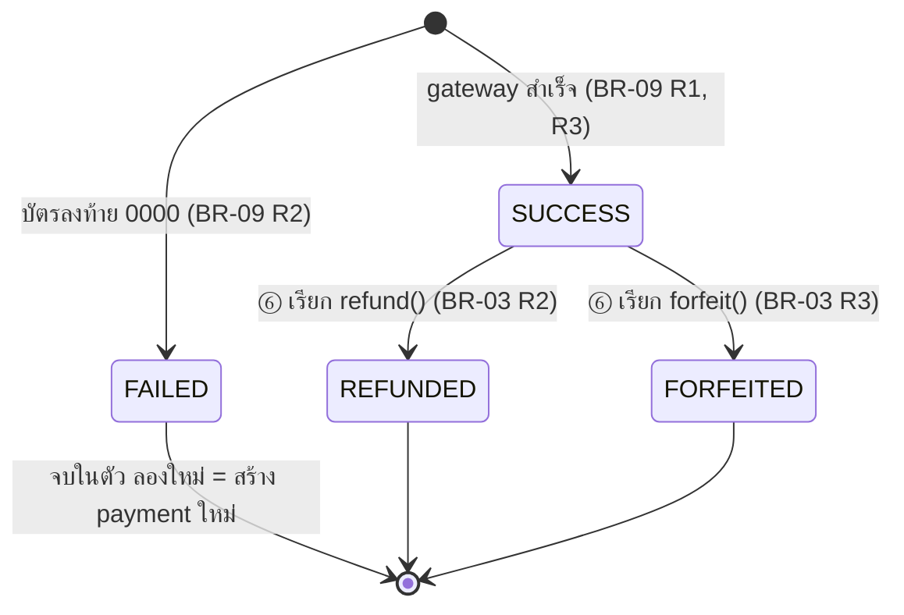
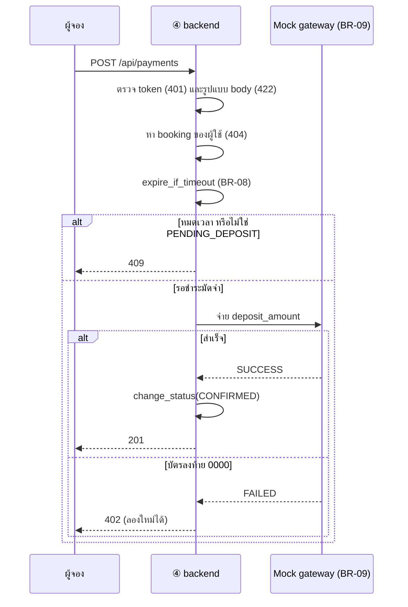

# โมเดลที่ feature ④ ชำระค่าบริการใช้ (MD-CTX-04, MD-DOM-04, MD-STM-04a, MD-STM-04b, MD-SEQ-04)

เวอร์ชัน 1.0 (draft ยังไม่เข้า Baseline) | เขียนด้วย Mermaid เปิดดูภาพได้บน GitHub
แปลงจากส่วน 6, 7 และ 8 ของ spec v1.0 (ไม่มีภาพจากบทเรียน Integrated Requirements Modelling ของ feature นี้) รหัส MD AI เสนอ ทีมยืนยันใน prompt-log

## MD-CTX-04 Context Diagram (เฉพาะส่วนที่ feature นี้แตะ)

## MD-DOM-04 Domain Model

ไม่มีฟิลด์เลขบัตรเต็มและ CVV (REQ-PRV-401)

## MD-STM-04a วงจรชีวิตของการจอง (เฉพาะส่วนที่ ④ แตะ)

## MD-STM-04b วงจรชีวิตของ payment

## MD-SEQ-04 ลำดับการจ่ายมัดจำ (ขั้นที่มี exception)

