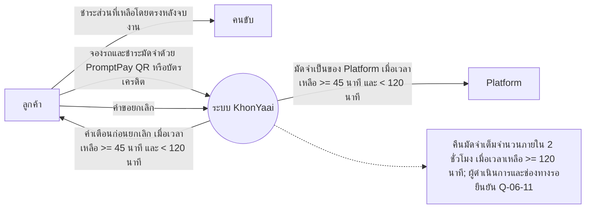
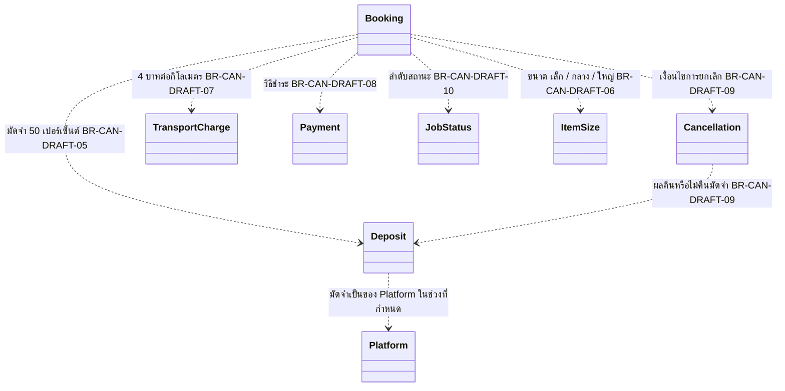
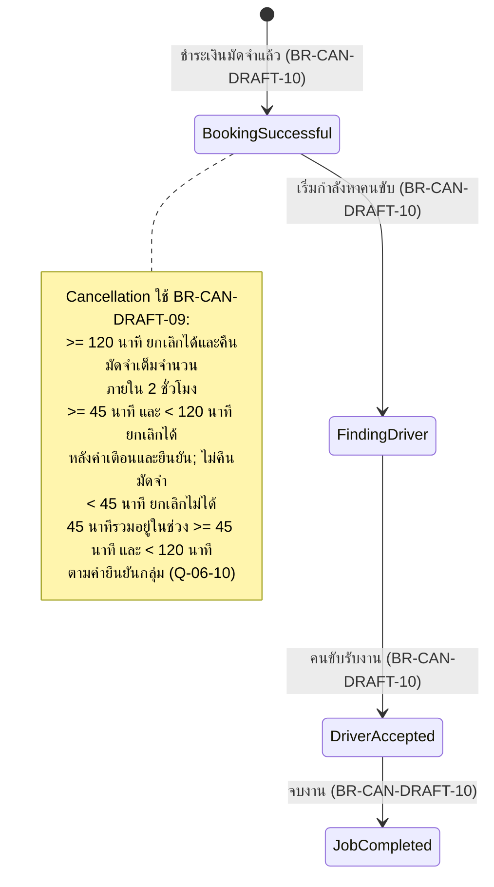

# โมเดลที่ feature นี้ใช้ (Draft MD-CTX-CAN-DRAFT, MD-DOM-CAN-DRAFT, MD-STM-CAN-DRAFT, MD-SEQ-CAN-DRAFT)

เวอร์ชัน 0.3 (Draft) | status: draft | ยังไม่มี Baseline ที่ยืนยันแล้ว
ที่มา: กฎชุดใหม่ใน specs/006-cancle/spec.md และ specs/006-cancle/rules.md
โมเดลทั้งหมดเป็น Conceptual Draft ไม่ใช่ข้อสรุปโครงสร้างหรือสถานะจริงนอกเหนือจากชื่อสถานะที่กลุ่มระบุ

## MD-CTX-CAN-DRAFT Context Diagram (Draft)



ไม่แสดงระบบภายนอกหรือ API เพราะไม่มีหลักฐานระบุระบบที่เชื่อมต่อ. การคืนมัดจำยังไม่ทราบวิธี ช่องทาง ผู้ดำเนินการ และจุดเริ่มนับ 2 ชั่วโมง (Q-06-11). กรณี 45 นาทีพอดีอยู่ในช่วง >= 45 นาที และ < 120 นาทีตามคำยืนยันจากกลุ่ม (Q-06-10).

## MD-DOM-CAN-DRAFT Domain Model (Conceptual Draft)



Entity เป็นแนวคิดเท่านั้น ไม่ใช่ชื่อตารางหรือ Database Schema และไม่มีการกำหนด Cardinality. ฐานคิดมัดจำรอยืนยัน Q-06-12; วิธีหาระยะทางรอยืนยัน Q-06-13; สถานะหลังยกเลิกและการเชื่อมกับ lifecycle รอยืนยัน Q-06-14; วิธีคืนเงินรอยืนยัน Q-06-11.

## MD-STM-CAN-DRAFT วงจรชีวิตสถานะงาน (Draft)



สถานะในเส้นทางงานใช้คำตามที่กลุ่มให้และเรียงตาม BR-CAN-DRAFT-10. ไม่เพิ่มสถานะ “ยกเลิก” เพราะยังไม่ได้ระบุชื่อ/ผลสถานะหลังยกเลิก; จุดเชื่อมการยกเลิกกับ lifecycle รอยืนยัน Q-06-14.

## MD-SEQ-CAN-DRAFT ลำดับการจอง การยกเลิก และการชำระส่วนที่เหลือ (Draft)

```mermaid
sequenceDiagram
  actor Customer as ลูกค้า
  participant KhonYaai as ระบบ KhonYaai
  actor Platform as Platform
  actor Driver as คนขับ

  Customer->>KhonYaai: จองรถล่วงหน้าอย่างน้อย 4 ชั่วโมง พร้อมวัน เวลา สถานที่ และขนาดสิ่งของ (BR-CAN-DRAFT-05, BR-CAN-DRAFT-06)
  Customer->>KhonYaai: ชำระมัดจำ 50 เปอร์เซ็นต์ด้วย PromptPay QR หรือบัตรเครดิต (BR-CAN-DRAFT-05, BR-CAN-DRAFT-08)
  KhonYaai-->>Customer: แสดงสถานะ จองสำเร็จ แล้ว กำลังหาคนขับ ตามลำดับ (BR-CAN-DRAFT-10)
  Driver-->>KhonYaai: รับงาน
  KhonYaai-->>Customer: แสดงสถานะ คนขับรับงาน (BR-CAN-DRAFT-10)

  Customer->>KhonYaai: ส่งคำขอยกเลิก
  alt เวลาเหลือ >= 120 นาที
    KhonYaai-->>Customer: แจ้งผลตาม BR-CAN-DRAFT-09
    Note over Customer,KhonYaai: ต้องคืนมัดจำเต็มจำนวนภายใน 2 ชั่วโมง; ผู้ดำเนินการ ช่องทาง และจุดเริ่มนับรอยืนยัน Q-06-11
  else เวลาเหลือ >= 45 นาที และ < 120 นาที
    KhonYaai-->>Customer: แสดงคำเตือนและขอให้ยืนยันก่อนยกเลิก (BR-CAN-DRAFT-09)
    Customer->>KhonYaai: ยืนยันการยกเลิก
    KhonYaai-->>Platform: มัดจำเป็นของ Platform (BR-CAN-DRAFT-09)
    Note over Customer,KhonYaai: รวมกรณีเหลือเวลา 45 นาทีพอดีตามคำยืนยัน Q-06-10
  else เวลาเหลือ < 45 นาที
    KhonYaai-->>Customer: แจ้งว่ายกเลิกไม่ได้ (BR-CAN-DRAFT-09)
  end

```

ลำดับนี้ไม่กำหนด API, Database Schema หรือระบบภายนอก. การคืนมัดจำเป็นผลตามกฎ แต่ไม่ได้ยืนยันว่า KhonYaai หรือ Platform เป็นผู้ดำเนินการจริง. การคิดยอดรวมจาก 4 บาทต่อกิโลเมตรขึ้นกับวิธีหาระยะทางที่รอยืนยัน Q-06-13; ฐานคำนวณเงินมัดจำ 50% รอยืนยัน Q-06-12. การคืนมัดจำสำหรับกรณีเหลือเวลา >= 2 ชั่วโมงยังรอยืนยันวิธีและเวลาเริ่มนับ Q-06-11.
