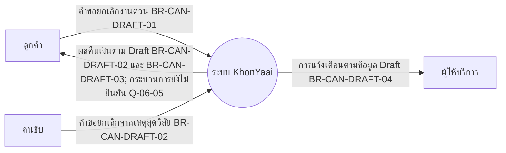
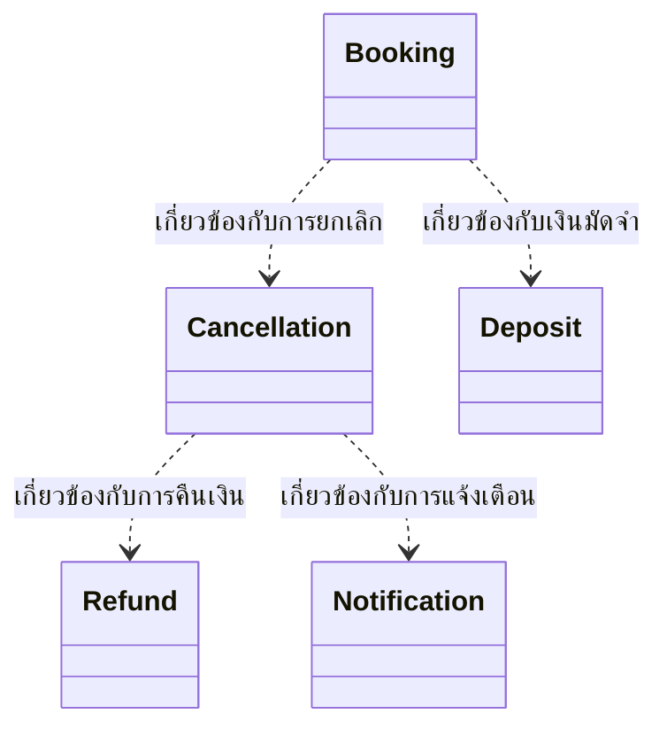

# โมเดลที่ feature นี้ใช้ (Draft MD-CTX-CAN-DRAFT, MD-DOM-CAN-DRAFT, MD-STM-CAN-DRAFT, MD-SEQ-CAN-DRAFT)

เวอร์ชัน 0.1 (Draft) | status: draft | ยังไม่มี Baseline ที่ยืนยันแล้ว
ที่มา: specs/006-cancle/spec.md และ specs/006-cancle/rules.md ฉบับ Draft
โมเดลทั้งหมดเป็น Conceptual Draft ไม่ใช่ข้อสรุปโครงสร้างหรือสถานะจริงของระบบ

## MD-CTX-CAN-DRAFT Context Diagram (Draft)



ไม่แสดงระบบภายนอก เนื่องจากยังไม่มีหลักฐานยืนยันว่าฟีเจอร์นี้ใช้งานระบบภายนอกใด รายละเอียดช่องทางแจ้งเตือนรอยืนยัน Q-06-07 ส่วนขั้นตอนคืนเงิน (ผู้เริ่มดำเนินการ วิธี/ช่องทาง และจุดเริ่มนับช่วงเวลา) ยังไม่มีข้อมูลยืนยัน โดยจุดเริ่มนับและชนิดวันรอยืนยัน Q-06-05; ความสัมพันธ์ระหว่างคนขับกับผู้ให้บริการรอยืนยัน Q-06-06.

## MD-DOM-CAN-DRAFT Domain Model (Conceptual Draft)



Entity ข้างต้นเป็นแนวคิดจาก Draft Requirements และ Draft Business Rules เท่านั้น ไม่ใช่ชื่อตารางหรือ Database Schema และไม่มีการกำหนด Cardinality หรือรายละเอียด attribute

ข้อมูลที่ยังไม่ยืนยันและยังไม่กำหนดเป็น Entity/attribute: การจองล่วงหน้า 1 วันและความสัมพันธ์กับ 24 ชั่วโมง (Q-06-03), นิยามเหตุสุดวิสัย (Q-06-04), จุดเริ่มนับและชนิดวันของช่วงคืนเงิน 7–15 วัน (Q-06-05), ความสัมพันธ์คนขับกับผู้ให้บริการ (Q-06-06), และรายละเอียดการแจ้งเตือน (Q-06-07).

## MD-STM-CAN-DRAFT วงจรชีวิตการยกเลิก (Draft)

```mermaid
stateDiagram-v2
  [*] --> BookingDraft: มีการจอง/งาน (Draft)
  BookingDraft --> CustomerCancellationPendingConfirmation: ลูกค้าส่งคำขอยกเลิกงานด่วน (BR-CAN-DRAFT-01)
  CustomerCancellationPendingConfirmation --> CustomerCancellationOutcomePendingConfirmation: เงื่อนไข 2 ชั่วโมงและผลต่อมัดจำรอยืนยัน Q-06-01, Q-06-02
  CustomerCancellationOutcomePendingConfirmation --> ProviderNotificationPendingConfirmation: การแจ้งผู้ให้บริการตาม BR-CAN-DRAFT-04; รายละเอียดรอยืนยัน Q-06-07

  BookingDraft --> DriverCancellationPendingConfirmation: คนขับส่งคำขอยกเลิกจากเหตุสุดวิสัย (BR-CAN-DRAFT-02)
  DriverCancellationPendingConfirmation --> DriverCancellationOutcomePendingConfirmation: การจองล่วงหน้า 1 วันและเงื่อนไข 24 ชั่วโมงรอยืนยัน Q-06-03; เหตุสุดวิสัยรอยืนยัน Q-06-04
  DriverCancellationOutcomePendingConfirmation --> RefundPendingConfirmation: ผลคืนเงินเต็มจำนวนตาม BR-CAN-DRAFT-02 และ BR-CAN-DRAFT-03; ช่วง 7–15 วันรอยืนยัน Q-06-05
```

ชื่อทุกสถานะเป็น Draft/Pending Confirmation เพื่อสื่อขั้นตอนที่ต้องทบทวน ไม่ใช่ชื่อสถานะจริงของระบบ และแผนภาพนี้ไม่กำหนดว่ากรณีใดอนุญาตหรือปฏิเสธการยกเลิก.

## MD-SEQ-CAN-DRAFT ลำดับการยกเลิก (Draft)

```mermaid
sequenceDiagram
  actor Customer as ลูกค้า
  actor Driver as คนขับ
  participant KhonYaai as ระบบ KhonYaai
  participant Provider as ผู้ให้บริการ

  Customer->>KhonYaai: ส่งคำขอยกเลิกงานด่วน (BR-CAN-DRAFT-01)
  Note over Customer,KhonYaai: ความหมายเงื่อนไข 2 ชั่วโมงรอยืนยัน Q-06-01; ผลต่อมัดจำรอยืนยัน Q-06-02
  Note over Customer,KhonYaai: ข้อมูล Draft ระบุว่าลูกค้าเสียเงินมัดจำเมื่อเป็นกรณีที่กำหนด; เงื่อนไขการใช้รอยืนยัน Q-06-01, Q-06-02
  KhonYaai-->>Provider: แจ้งเตือนตามข้อมูล Draft (BR-CAN-DRAFT-01, BR-CAN-DRAFT-04)
  Note over KhonYaai,Provider: เวลา ช่องทาง และรายละเอียดแจ้งเตือนรอยืนยัน Q-06-07; คนขับกับผู้ให้บริการเป็น actor เดียวกันหรือไม่รอยืนยัน Q-06-06

  Driver->>KhonYaai: ส่งคำขอยกเลิกโดยระบุเหตุสุดวิสัย (BR-CAN-DRAFT-02)
  Note over Driver,KhonYaai: ความสัมพันธ์และความหมายของเงื่อนไขรอยืนยัน Q-06-03; นิยามเหตุสุดวิสัยรอยืนยัน Q-06-04
  Note over Customer,KhonYaai: ข้อมูล Draft ระบุการคืนเงินเต็มจำนวน (BR-CAN-DRAFT-02, BR-CAN-DRAFT-03); กรอบ 7–15 วันคงตามข้อมูล Draft และจุดเริ่มนับ/ชนิดวันรอยืนยัน Q-06-05
```

ลำดับในแผนภาพเป็นการสรุปข้อมูล Draft ไม่ได้กำหนด API Endpoint, Payment Gateway, Notification Service หรือกลไกภายในอื่น. กระบวนการคืนเงินที่ยังไม่ทราบ ได้แก่ ผู้เริ่มดำเนินการ วิธี/ช่องทางคืนเงิน การส่งต่อไปยังระบบใดหรือไม่ และเหตุการณ์ที่ใช้เริ่มนับช่วง 7–15 วัน; จุดเริ่มนับและชนิดวันรอยืนยัน Q-06-05. Diagram แสดงเฉพาะผลที่ข้อมูล Draft กล่าวถึง ไม่ได้ยืนยันว่าระบบ KhonYaai เป็นผู้คืนเงินหรือว่าการคืนเงินเกิดขึ้นโดยอัตโนมัติ.
